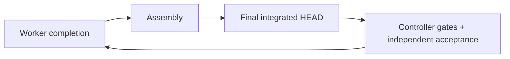

# Sandcastle: достижимая приёмка и долговечные runtime evidence

Дата: 2026-10-10. Статус: P0/P1 реализованы в отдельном framework change set; migration и возобновление actual run не выполнялись.

Исследование завершено по собранным данным. Storage protocol и migration ниже сохраняют исходный проект; реализованный subset и проверки перечислены в конце. Долговечность на host означает сохранность при container teardown/restart, а не резервную копию при потере самого host disk.

Рекомендация: сделать **владение проверками и фазу их выполнения машинно проверяемыми**, а захват и публикацию evidence — ответственностью контроллера. Worker передаёт проверенный committed delivery; assembly делает результат доступным зависимым implementation slices; обязательные gates и независимая приёмка выполняются после интеграции. Нельзя требовать конечную приёмку как условие передачи результата на интеграцию. Evidence публикуются вне Git в controller-owned store с проверяемой identity и атомарным переходом из staging в sealed bundle.

Это устраняет две подтверждённые структурные причины. Обещать нулевую вероятность любого будущего сбоя нельзя: остаются ошибки runner, неполные требования, потеря host disk и семантические ошибки reviewers. Для двух разобранных классов система должна отвергать невозможный план до worker dispatch и не признавать недолговечные/устаревшие evidence доказательством.

## Исследованные источники и ограничения

Проверены текущие `.sandcastle/*.mjs`, schemas, профильные tests, [workflow documentation](/home/svechnik/Projects/tomenet_modern_client/docs/sandcastle.md:31), AGENTS.md, CONTEXT.md, domain/tracker rules, ADR-0003 и ADR-0005. Эти ADR относятся к клиенту: для framework ниже они лишь согласуют явное владение и lifetime, а не вводят новую обязанность SV. Внешние источники не требовались.

Зафиксированные ревизии: launch checkout `cc904d55839993c3cc779b8bd9089e2402910adb`; integration `72fac69a58b7875f1d812980312acaa63573d4c9`; worker `48edfae35ce46996dd8c5337dacf6ecd5afe90b5`, содержащий `4bb9c17479807fc95ae44ee317500297eab7b9df`; reviewed HEAD `9a98594669cba32bef9d98236cf8f0902a27eba0`. В main нет `.scratch/sandcastle-0241e0da/` и runtime collector. Их строки проверены через `git show <точная-ревизия>:<путь> | nl -ba`; ссылки на отсутствующие файлы не используются как будто это launch checkout.

Первичные branch sources: на worker revision выше `.scratch/sandcastle-0241e0da/issues/09-final-head-runtime-evidence.md` (далее **W09**) и `evidence/09/README.md` (**W09E**); на integration revision — `acceptance-contract.json` (**C**), `issues/07-runtime-audit.md` (**I07**) и `tests/sv_birth_runtime_evidence.py` (**R**), все scratch paths под `.scratch/sandcastle-0241e0da/`. Команда воспроизведения, например: `git show 48edfae35ce46996dd8c5337dacf6ecd5afe90b5:.scratch/sandcastle-0241e0da/issues/09-final-head-runtime-evidence.md | nl -ba`.

Данные о 108 новых сессиях/347 artifacts/142 fingerprints в W09 — **сообщения автора**, не независимо подтверждённый новый acceptance result. Удалённые container captures недоступны для прямого readback; фактический Docker mount snapshot прежнего worker не сохранён как evidence artifact. Вывод о lifetime подтверждается конфигурацией provider, его cleanup и повторным сообщением об отсутствии каталога; байтовую корректность утраченных captures это не доказывает. Production SV behavior и полная runtime-приёмка здесь заново не проверялись. Run, его state, бюджеты, Git и heartbeat не изменялись.

## Проблема 1: фазовый цикл, пропущенный проверкой зависимостей

1. Контракт C имеет `completionScope: implementation` (L4), но runtime proof остаётся mandatory/current: P1-ac3 (L40), P1-ac6 (L87), P1-ac8 (L118), P2-4. Их controller review должен установить production-path evidence. Scope не разрешает удалить эту обязанность; отдельный P1-entry-evidence deferred к SV-B-025.
2. W09 L22–26 требует reviewed-HEAD capture, независимый controller verdict, **повторный capture после integration/resolution commit** и final sv-build/sv-core/controller-review. W09 L5 сообщает только completed dependency 08. Следовательно обычный ticket DAG выглядит достижимым, хотя actual stage graph цикличен.
3. [implementWorker](/home/svechnik/Projects/tomenet_modern_client/.sandcastle/workflow.mjs:468) запрещает worker запускать полный workflow (L474), а `completed` требует resolved ticket с Answer (L480–486). W09 L123–130 прямо сохраняет `claimed` и просит сначала assembly, затем controller gates. Это честный отказ утверждать недоступную независимую приёмку.
4. [collectWave](/home/svechnik/Projects/tomenet_modern_client/.sandcastle/parallel.mjs:94) собирает только `status === completed` (L97); остальных возвращает в parallel-work и бросает ошибку (L115–123). [assemble](/home/svechnik/Projects/tomenet_modern_client/.sandcastle/workflow.mjs:511) дополнительно запрещает merge blocked branches (L520). Gates находятся после assembly: [build/testGate](/home/svechnik/Projects/tomenet_modern_client/.sandcastle/workflow.mjs:540), затем [review](/home/svechnik/Projects/tomenet_modern_client/.sandcastle/workflow.mjs:611).
5. Фактическая цепочка записана в [events seq 45–58](/home/svechnik/Projects/tomenet_modern_client/.sandcastle/runs/0241e0da/events.jsonl:45): evidence finding → план 09 → blocked → assembly failure → recovery repair → blocked → stop. Последний [state](/home/svechnik/Projects/tomenet_modern_client/.sandcastle/runs/0241e0da/state.json:2320) сохраняет wave 6 и worker HEAD; finding open, repairs 0 (L2296–2314); resume checkpoint parallel-work (L2368).
6. [recovery 2](/home/svechnik/Projects/tomenet_modern_client/.sandcastle/runs/0241e0da/recovery-2.json:6) просит assemble с pending acceptance. Но [recoveryTarget](/home/svechnik/Projects/tomenet_modern_client/.sandcastle/recovery-guidance.mjs:11) направляет parallel-work advice только blocked/failed workers; assembly имеет другую фазу (L43). Изменить scheduler prose-инструкцией нельзя. [Recovery 3](/home/svechnik/Projects/tomenet_modern_client/.sandcastle/runs/0241e0da/recovery-3.json:6) распознаёт цикл и останавливается, не обходит gate.

Корень: в worker acceptance попала обязанность более поздней controller phase, а framework не моделирует этого владения. [validateTicketBatch](/home/svechnik/Projects/tomenet_modern_client/.sandcastle/tickets.mjs:46) проверяет только path/order/blockedBy, не criterion ownership, delivery predicates и stage reachability. [acceptPlan](/home/svechnik/Projects/tomenet_modern_client/.sandcastle/workflow.mjs:420) лишь валидирует manifest и наличие файлов; Markdown completion checks [L71](/home/svechnik/Projects/tomenet_modern_client/.sandcastle/tickets.mjs:71) не доказывают все обязанности. Наличие Answer/resolved само по себе не равно acceptance.

Это уже проявлялось в I07 L51–73 и [recovery 1](/home/svechnik/Projects/tomenet_modern_client/.sandcastle/runs/0241e0da/recovery-1.json:6). Тогда worker запустил дополнительные gates/review на собственной ветке; последующая интеграция изменила HEAD и общий review снова потребовал final proof. Это обход порядка в одном worker, а не системное устранение причины. Отдельная ошибка Python PATH в I07 L63–67 была исправлена и не объясняет нынешний фазовый цикл.

## Проблема 2: outside Git не означает durable; proof связан с предыдущим HEAD

1. W09 L63–74 указывает capture в `/home/agent/sv-b024-final-audit/<HEAD>/runtime`; W09E L13–29 называет каталог persistent. Это path внутри home container, вне mounted workspace. W09 L109–116 и W09E L74–94 затем фиксируют, что каталог исчез и persistence/controller access не были проверены.
2. [sandboxProvider](/home/svechnik/Projects/tomenet_modern_client/.sandcastle/workflow.mjs:452) добавляет mounts skills/auth/runtime schemas; evidence mount отсутствует. В установленном Sandcastle 0.12.0 [Docker provider](/home/svechnik/Projects/tomenet_modern_client/node_modules/@ai-hero/sandcastle/dist/chunk-CP3TYXZA.js:134) складывает internal workspace/Git mounts и user mounts (L134–142). `/home/agent` целиком не является host storage. Provider [close](/home/svechnik/Projects/tomenet_modern_client/node_modules/@ai-hero/sandcastle/dist/chunk-CP3TYXZA.js:314) удаляет container через stop/rm (L109–111); shutdown также [rm -f](/home/svechnik/Projects/tomenet_modern_client/node_modules/@ai-hero/sandcastle/dist/chunk-CP3TYXZA.js:197).
3. [closeExecution](/home/svechnik/Projects/tomenet_modern_client/.sandcastle/dispatch.mjs:26) сохраняет Git changes, затем всегда close; не экспортирует произвольный evidence directory. `copyFileOut` уже есть в provider [L301](/home/svechnik/Projects/tomenet_modern_client/node_modules/@ai-hero/sandcastle/dist/chunk-CP3TYXZA.js:301), но workflow здесь не применяет его к captures. Коммит Git и сохранение state не сохраняют writable layer.
4. [Review finding](/home/svechnik/Projects/tomenet_modern_client/.sandcastle/runs/0241e0da/review-1.json:126) отдельно различает старый tested HEAD `236843…` и reviewed HEAD `9a985…`, отсутствующий external directory и passing build/core. Совпадающие source fingerprints не превращают старую трассу в точный новый HEAD. Worker docs commit `4bb9…`, recovery docs commit `48edf…`, будущий assembly HEAD — ещё другие revisions.

Корень хранения: нет controller-owned evidence destination, protocol публикации, host readback и проверки persistence перед teardown. Корень повторного захвата: receipt/report/ticket commits и verification не имеют устойчивого порядка. Сам collector R не обещает durability: output arbitrary (L35–40), manifest пишется напрямую (L73–75); нет atomic seal/controller publication. Его existing guards полезны: пустой каталог, удаление inherited case filters (L42–47), source hashes (L48–52), artifact hashes (L89–91), unchanged HEAD/inputs (L97–103), gates explicitly pending (L62–68). Они не проверяют host visibility, clean Git tree, actual toolchain/image identity или independent semantic verdict.

[Contract runner inventory](/home/svechnik/Projects/tomenet_modern_client/.sandcastle/contract-runners.mjs:18) уже отклоняет отсутствующие focused scripts, но проверяет существование, не исполнимость аргументов/output/lifetime. В C runtime criteria отображены в `controller-review`, а не исполняемый collector check. [testGate](/home/svechnik/Projects/tomenet_modern_client/.sandcastle/workflow.mjs:584) пропускает review kind, [review](/home/svechnik/Projects/tomenet_modern_client/.sandcastle/workflow.mjs:624) получает лишь saved check evidence. В итоге framework не обязан запустить runtime collection до review — planner пытается компенсировать это verification ticket. Collector к тому же добавлен после фиксации C: inventory до implementation не мог выдать отсутствующий тогда script за runnable proof.

## Что уже защищено и должно сохраниться

[closureGate](/home/svechnik/Projects/tomenet_modern_client/.sandcastle/acceptance.mjs:185) требует HEAD+contractDigest для checks/assessment, mandatory passed, отсутствие open blockers и ожидающих интеграции workers. [applyAssessment](/home/svechnik/Projects/tomenet_modern_client/.sandcastle/acceptance.mjs:160) не закрывает finding молчанием; explicit resolution необходим. [gate](/home/svechnik/Projects/tomenet_modern_client/.sandcastle/workflow.mjs:181) требует clean HEAD и не допускает его изменения во время проверки. [repositoryGateInput](/home/svechnik/Projects/tomenet_modern_client/.sandcastle/gate-input.mjs:6) берёт core runner из checked worktree; [checkEvidence](/home/svechnik/Projects/tomenet_modern_client/.sandcastle/workflow.mjs:603) сохраняет runner hash в host JSON, но acceptance entry пока хранит только check/head/pass/path/digest ([recordCheck](/home/svechnik/Projects/tomenet_modern_client/.sandcastle/acceptance.mjs:96)).

[preflightExecution](/home/svechnik/Projects/tomenet_modern_client/.sandcastle/execution.mjs:135) уже связывает agent dispatch с controller, Git, schema/checks, CLI и actual image identity. Это следует использовать для check execution, а не создавать параллельный несовместимый provenance формат; agent dispatch provenance не является автоматически check receipt. Нельзя сохранять whole environment.

После final audit уже допускаются строго перечисленные report/recovery/residual paths: [assertAuditedChanges](/home/svechnik/Projects/tomenet_modern_client/.sandcastle/acceptance.mjs:218) и [verifiedTree](/home/svechnik/Projects/tomenet_modern_client/.sandcastle/workflow.mjs:684). [Report](/home/svechnik/Projects/tomenet_modern_client/.sandcastle/workflow.mjs:640) явно хранит Verified code HEAD. Это существующее решение report-only descendants; не нужно вводить broad «любой docs-only commit можно reuse». Evidence/receipt/ticket paths не входят в разрешённый список. Вердикт остаётся привязанным к tested code HEAD, а publication HEAD объявляется отдельно.

## Варианты

| Вариант | Что меняется | Преимущества | Недостатки |
|---|---|---|---|
| A. Только prompts и общий persistent mount | Planner просит worker-local DoD; /home/agent evidence mount | Быстро, мало изменений | Нет доказательства reachability/ownership; произвольная Markdown обязанность снова создаёт цикл; общий writable store позволяет overwrite receipts. Не достаточен |
| B. Typed delivery + stage-owned verification + sealed evidence module | Небольшой execution plan и delivery receipt; collector gates после assembly; controller публикует bundles | Детерминированное разделение обязанностей, сохраняет строгую приёмку, локальные изменения framework | Нужно schema/version migration, executable artifact gate и несколько integration tests. **Рекомендуется** |
| C. Универсальная task graph/state machine с completed_pending, partially accepted и per-ticket gates | Все workers/gates/review становятся произвольными graph nodes | Подходит множеству разных workflow | Большая Interface и миграция; статус сам по себе не ловит cycle; сложнее counters и scheduler. Сейчас не требуется |

B не разрешает автоматически merge любого blocked результата и не требует global enum `completed_pending`. Для корректно спланированного worker существующее `completed` означает выполненный **локальный delivery contract**. Run acceptance живёт отдельно. Нынешняя смешанная задача требует явной проверяемой migration/handoff, а не переименования `blocked` в `completed`.

## Рекомендуемый deep module и четыре разные готовности

Seam — между plan/worker/assembly и controller check/assessment publication. Deep module `verification.mjs` скрывает dependency reachability, durable storage, identity checks и restart protocol за небольшой Interface:

- `validatePlan(contract, executionPlan, inventory)` возвращает нормализованный план либо typed error с cycle trace/missing owner.
- `acceptDelivery(ticket, revision, localResults)` возвращает receipt только для выполненных worker-local predicates и committed clean revision; не принимает independent acceptance claims.
- `executeCheck(checkBinding, target)` исполняет объявленный runner, публикует sealed bundle/failed attempt и возвращает durable receipt.
- `verifyEvidence(receipt, target)` независимо читает sealed bundle, проверяет identity/integrity и предоставляет verified facts для assessment. Семантический independent audit остаётся существующей отдельной ролью, не заменяется hashing.

Storage/provider и runner — внутренние Adapter: host files плюс bind-mounted staging, существующие core/command runners плюс artifact runner. Не вводить универсальную bus или публичные callback на каждое состояние. Callers/tests пересекают ту же Interface, что production workflow.

| Понятие | Кто и что устанавливает | Чего это не доказывает |
|---|---|---|
| Delivery ready | Controller проверил committed revision, local predicates и receipt; допускается assembly | Run acceptance, отсутствие integration defects |
| Implementation done | Worker выполнил assigned production behavior/collector/tools и focused checks | Независимый final runtime audit |
| Dependency ready | Assembly проверила ancestry, clean tree и integrated delivery; predicate зависимости выполнен | Право считать run accepted |
| Run acceptance | Required gates + review + fresh final audit на frozen HEAD/digest, ledger closure | Native/platform/downstream checks, если они законно deferred |

Verification-only worker может завершить доставку runner/procedure/fixtures без объявления production feature принятой. Generated Markdown показывает отдельные `Worker delivery criteria` и `Controller acceptance obligations` с owner/phase. Нельзя считать оба набора [x] только потому, что worker готов. [focused test ticket](/home/svechnik/Projects/tomenet_modern_client/.sandcastle/tickets.mjs:28) уже допускает resolved local task с pending deferred checks; новый дизайн формализует ownership также для **current mandatory** controller checks. Они остаются required/pending и блокируют closure, хотя не блокируют worker delivery.

Переходы: `planned → worker running → delivery ready → integrated/dependency ready → frozen target → required checks → evidence integrity → independent review → fresh final audit → run accepted → publication`. Failure before delivery запрещает assembly; gate failure после интеграции ведёт в repair delivery, не назад к фиктивному unresolved worker. Late evidence от предыдущего target остаются историческими и не применяются. Finding закрывает только independent assessment на current target, не worker result и не `acceptDelivery`.

## Contract/planning preflight: достижимость до расхода inference

Нормативный contract сохраняет requirement/mandatory/applicability/source/owner. Отдельный typed **execution plan**, связанный с digest, добавляет executor (`worker`, `controller`, `external`), phase, target (`worker revision`, `integrated HEAD`), input dependencies, delivery predicates, evidence specification и verification owner. Для новых contracts эти facts должны независимо проверяться вместе с contract, но не подменять нормативные источники. Поле criterion.owner сейчас часто означает owning SV ticket, а не исполняющий процесс: смешивать их нельзя.

Plan validator строит graph не только из `blockedBy`, но и implicit transitions: delivery → assembly → integrated target → build/core/artifact gate → review → final audit. Каждое completion predicate связано с producer node. Self/forward stage dependency либо SCC возвращает `PLAN_STAGE_CYCLE` с цепочкой `09 delivery → assembly → final HEAD → controller acceptance → 09 delivery`. Missing producer/runner/environment даёт свой typed diagnostic до dispatch. Regex на словах «final HEAD» полезен для warning, но не доказательство: structured predicates обязательны, а independent planner review сверяет полноту Markdown со schema.

Worker не может владеть final integrated HEAD, controller verdict или full workflow predicate. External deferred node не участвует в worker frontier. Current mandatory verification не может исчезнуть при переносе из worker в controller. Каждый runtime criterion имеет evidence specification: producer runner/expected matrix/backend, integrity verifier и semantic reviewer. `controller-review` допускается без artifact runner для inspection-only obligation; runtime requirement не может закрываться одним prose `passed` без проверенного artifact receipt.

Если runner должен быть создан текущей задачей, plan содержит delivery prerequisite `runner delivery → assembly → artifact gate`; inventory проверяет реально доставленный runner перед freeze. Контракт не обязан ложно объявлять его доступным заранее. Для существующего C нужен additive execution binding к неизменному controller-review, обязательный при сборе/runtime assessment, а не молчаливое изменение contract checks/digest. Binding должен иметь собственный digest, проверку coverage и запрет removal/reinterpretation требований; если такая faithful mapping невозможна, scope decision обязателен.

Recovery различает `PLAN_STAGE_CYCLE`, `EVIDENCE_MISSING`, `EVIDENCE_NOT_DURABLE`, `EVIDENCE_STALE`, runner failure и actual external missing dependency. Cycle отправляется в ownership/plan correction, не в повторение worker с assembly instructions. Publisher failure повторяет publication того же sealed attempt, не запускает все сессии снова. Семантические выводы старого reviewer не попадают в fresh final auditor через recovery guidance.

## Controller-owned durable evidence store

Layout: `.sandcastle/runs/<run>/evidence/<contractDigest>/<verifiedHead>/<checkId>/<attemptId>/` на host, вне Git. Writer получает только свой новый `staging/<attemptId>/` через mount `/home/agent/.sandcastle-evidence-out`; workers не получают writable final store или чужие attempts. Controller владеет sealed directories, index и receipts. Independent inspectors читают host paths, runtime проверка читает sealed mount readonly. Нельзя указывать произвольный `/home/agent/...` как durable storage.

Preflight создаёт host staging с закрытыми permissions, проверяет writable capacity и host↔container mapping без inference; controller проверяет пробный safe file и mount identity. Проверка после actual container teardown читается с host/restarted inspector. Probe не доказывает отсутствие позднего disk failure, поэтому commit receipt требует полного фактического readback. Cleanup container разрешён даже при failure, потому что staging уже host-backed; неполный attempt остаётся failed/incomplete и никогда не засчитывается. Хранить весь container ради captures не нужно.

Публикация attempt:

1. Controller резервирует unique attemptId и target identity; saves checkpoint до запуска. HEAD/contract/binding фиксированы. Runner получает fresh empty staging directory и безопасный argv/output specification, а не shell interpolation произвольного path.
2. После запуска controller завершает процессы runner/peers, запрещает дальнейших writers и копирует staging в **controller-only temporary directory**. Не seal/rename самого общего writable staging: оставшийся writer/file descriptor может изменить опубликованные файлы.
3. Проверяет schema, завершённость matrix, exit codes, expected file allowlist, regular files, size/hash; запрещает symlinks/path traversal/hardlink tricks, unknown/extra files и escapes. Хеши вычисляет controller по собственной копии, не доверяет author manifest как единственному oracle. Incomplete/failed попытки сохраняет с честным status.
4. Пишет manifest и receipt, flush/fsync files, атомарно rename directory на том же filesystem, fsync parent directory. Только затем публикует receipt reference в атомарном state/index checkpoint. Sealed attempt immutable по protocol/permissions; restart revalidates hashes. Права readonly сами по себе не защита от malicious host с тем же UID: контроль writer lifetime и controller-only копия необходимы; полноценная adversarial isolation потребовала бы отдельного OS principal.
5. Crash до rename оставляет incomplete staging; после rename до state update restart находит orphan sealed receipt, валидирует exact identity и идемпотентно восстанавливает reference. Повторный attempt не перезаписывает первый. GC по явной retention policy запрещён для evidence текущего open/accepted run; автоматический teardown store не удаляет.

Receipt связывает runId, **verified HEAD**, contractDigest, execution binding digest, checkId, attemptId, controller digest, runner path+hash и транзитивные declared inputs, exact safe argv, runtime image ID, toolchain/interpreter identity, backend/OS/architecture, разрешённые environment settings, timestamps, actual exit codes, expected/actual cases, artifact paths/sizes/hashes, producer role и validator version. Compiler flags, native libraries и executable hash записываются, если они влияют на результат; Git source hash не заменяет build identity. Collector R hardcoded contract digest должен совпадать с controller target, а для повторного использования runner лучше принимать проверенный digest как явный input.

`producer succeeded`, `integrity verified` и `independently semantically accepted` — отдельные records. Independent assessment ссылается на receipt ID/hash и target, не на свободный prose path. Final closure снова проверяет существование и integrity sealed bundles, соответствие runner/runtime target и HEAD; найденный missing/tampered/stale bundle блокирует `ready`, даже если старый state содержит passed. Actual runtime identity не должна сравниваться с произвольным будущим image tag: для reuse требуется точная проверенная identity.

Запрет секретов: не писать auth paths, credentials, полное env, реальные account/network request logs. Runtime captures разрешать только для synthetic controlled peer с заранее известными test identities/payloads и declared artifact classes; collector отвергает real-server target. В этот design документ raw requests/replies не копируются. Redaction, если нужна, создаёт отдельный sanitized artifact с provenance и не меняет retained bytes незаметно; источник, который нельзя безопасно retain, не считается достаточным evidence. Artifact scanning дополняет allowlist, но не обещает найти каждый возможный secret.

## Устойчивый exact HEAD и конец повторных captures

Все implementation, runner, planning, delivery и ticket bookkeeping commits выполняются **до freeze**. Затем controller фиксирует `verificationTarget = {head, contractDigest, bindingDigest, controllerIdentity}` и не допускает Git writers до gates/audit. Проверяет HEAD/tree/dirty before и after каждого check, перед сохранением assessment и publication. Для internal observer/runners preferred execution — отдельный clean target checkout; проверяется соответствие target и сборочного executable, а не текущее название branch. Lock/lease target нужен также между integrity readback и assessment commit: одних before/after hashes при параллельном writer недостаточно.

Runtime manifests, audit responses, acceptance receipts и metadata статусы controller tasks сохраняются вне Git. Они не создают новую целевую ревизию. Final auditor проверяет тот же sealed target; finding resolution не требует commit «receipt для commit, который содержит receipt». После изменения production, runner, contract binding либо неразрешённого ticket/evidence file freeze снимается и gates/audit проходят на новом target; старые records остаются историей, не переименовываются.

После принятия допускается существующий report-only descendant policy: report явно различает `verified code HEAD` и `publication HEAD`. Применять [assertAuditedChanges](/home/svechnik/Projects/tomenet_modern_client/.sandcastle/acceptance.mjs:218), сохраняя ancestry и строгий allowlist. Не расширять whitelist на любые `docs/`, `.scratch/`, collector receipts или ticket resolution. Дополнительно учитывать полную цепочку commits/readonly executable inputs: net diff не должен быть способом спрятать временный code/runner mutation во время проверки. Broad cross-HEAD reuse даже при одинаковых source fingerprints для этой задачи не рекомендуется: это изменило бы exact-HEAD obligation.

Controller-owned verification node завершается в run store после проверенного audit; generated historical mixed ticket не обязан получать post-audit resolution commit. Если требуется Git-правка его Status/Answer, её делают до нового freeze как **перенос ownership/историческая запись**, без объявления будущей проверки passed, либо запускают новый честный cycle. Final result отражает completion controller node в допустимом report. Это сохраняет local Markdown history и убирает самоссылку, не выдумывая completed acceptance задним числом.

## Внедрение и безопасная migration 0241e0da

**P0 — обязательные исправления причин**, отдельный framework change set: typed ownership/phase plan + reachability validation; delivery receipt/assembly predicate; artifact gate и durable publisher; runtime receipt-backed acceptance; exact frozen target. Все изменения framework/tests/docs отдельно от SV feature commits. SV collector schema/input adaptation при необходимости — отдельный feature test/tool change set, без изменения production/legacy/shared behavior.

**P1 — controlled migration и доказательства**: CLI migration/resume с preview, typed saved-checkpoint constraints, атомарной записью и журналом authorization; integration scenarios ниже. **P2 — необязательные улучшения**: artifact size/retention dashboards, export/backups, более точная pause classification, затраты/время gates. Они не обязательны для снятия нынешних причин и не входят в feature scope.

Для нынешнего run после явной авторизации ремонта/возобновления:

1. Сохранить snapshot/archive existing state/events/branch refs; проверить awaiting/parallel-work, wave 6, точные worker/integration HEADs, contract digest `0ba2cedc9474a7f17f847c0bdb89d04023b0a9edefa8611f7528564eeb4f83ef`, open finding D-9496281ca15e0741. Migration не снимает pause автоматически и не редактирует state вручную.
2. Отделить исторический W09 mixed contract: committed worker delivery проверяется отдельно; original independent/final-HEAD обязанности становятся controller verification node, остаются pending. Сохранить W09 claimed/blocked history; не выставлять ему resolved и не закрывать finding ради assembly. Поддерживаемый delivery receipt для этого **точного** revision разрешён только после проверки diff/ancestry/local predicates и полного перечисления перенесённых обязательств. В обычных будущих plans local delivery child может быть resolved; в этом legacy mixed checkpoint нужен явный migration record, не generic merge blocked.
3. Collection принимает этот validated delivery receipt как основание merge exact `48edf…` с сохранением `4bb9…`; failed/blocked без receipt всё ещё запрещены. Worker readiness и controller task readiness сохраняются отдельно; original 09 больше не используется как worker completion predicate. Расширенная closure проверяет отсутствие unfinished **delivery** и все controller nodes, поэтому claimed historical record не создаёт новый gate cycle. Counters repairs считают integrated mapped delivery, а не audit conclusion; сохранить прежние цифры/историю, не начислять двойную интеграцию при replay.
4. Additive execution binding к C.controller-review связывает P1-ac3/P1-ac6/P1-ac8/P2-4 с существующим R и independent verifier. Переносит execution, не requirements/check mappings/digest; независимо проверить faithful coverage. Не amend исходный C, не сбрасывать assessments/ledger. R воспроизводит 108 сессий без filters; empty directory/manifest proof and controller integrity mandatory. Утраченные captures не «восстанавливаются» декларацией автора; optional reviewed-HEAD историческая реконструкция не заменяет final target.
5. После всех integration/metadata/tool commits freeze new exact HEAD. Запустить actual sv-build, configured sv-core и artifact capture с `/opt/sv-venv`/подтверждённой runtime identity. Сохранить новые bundles на host; прочитать после container close/restart. Старые build/core receipts остаются доказательством своих HEADs, не нового.
6. Существующий независимый review и fresh final audit читают sealed artifacts и original C; только evidenced resolution закрывает D-9496281ca15e0741. Retain deferred P1-ac12/P1-entry-evidence owner SV-B-025 и SV-B-023/native acceptance limits. Report сохраняет verified HEAD/publication HEAD отдельно; integrate лишь после closure. Quota, attempt, repair/final-audit/recovery limits не повышаются и не обнуляются; если имеющихся allowances не хватает, это отдельный user decision, не скрытая часть migration.

## Проверки и критерии успешности

Расширить существующие production module tests: [tickets](/home/svechnik/Projects/tomenet_modern_client/tests/sandcastle_tickets.mjs:8) (dependency/completion), [parallel](/home/svechnik/Projects/tomenet_modern_client/tests/sandcastle_parallel.mjs:22) (siblings/integration readiness), [acceptance](/home/svechnik/Projects/tomenet_modern_client/tests/sandcastle_acceptance.mjs:315) (real Git/check/report), [gate input](/home/svechnik/Projects/tomenet_modern_client/tests/sandcastle_gate_input.mjs:32), [runner inventory](/home/svechnik/Projects/tomenet_modern_client/tests/sandcastle_contract_runners.mjs:14), [dispatch](/home/svechnik/Projects/tomenet_modern_client/tests/sandcastle_dispatch.mjs:5), [recovery guidance](/home/svechnik/Projects/tomenet_modern_client/tests/sandcastle_recovery_guidance.mjs:68), [resume](/home/svechnik/Projects/tomenet_modern_client/tests/sandcastle_resume.mjs:30). Новые tests publisher/plan module вызывают тот же Interface, что workflow; fixtures должны моделировать конкретную опасную ситуацию, не повторять код.

| Regression/integration scenario | Требуемый наблюдаемый исход |
|---|---|
| W09-подобный ticket с completed blockedBy, но final gate в local DoD; цикл через 2–3 tickets | PLAN_STAGE_CYCLE до inference, trace фаз; ни wave, ни fake completion |
| Правильный worker delivery, independent acceptance pending | Assembly и implementation dependencies доступны; closure blocked, finding open; explicit controller gate завершается после assembly |
| Blocked worker с missing implementation/environment, но есть commit | Commit сохраняется; без validated delivery receipt merge и dependency readiness запрещены |
| Interrupted assembly/migration после merge до state save | Ancestry replay без duplicate merge/repair counting; saved budgets/old blocked history unchanged |
| Runtime criterion замаплен только в controller-review, producer не объявлен/не доставлен | Preflight отклоняет; script с обязательным output argv не объявляется runnable по одному существованию path |
| Real Docker writer, capture в mounted staging; close и новый inspector/controller | Полный bundle доступен и совпадает; unmounted /home/agent attempt отвергнут как nondurable |
| Crash на каждом publication шаге, disk full/copy/hash failure | Только sealed verified attempts могут pass; replay идемпотентен, incomplete/orphan attempts восстановлены честно |
| Writer продолжает запись, symlink outside root, изменён artifact после receipt | Controller snapshot/seal не принимает чужие bytes; final revalidation blocks tampering |
| HEAD/source/runner/check arguments/runtime/backend/contract binding изменились; late result старой generation | Старый receipt не применяется к новому target; никаких тихих false passes |
| Receipt/documentation создаётся вне Git; затем allowlisted report commit | Capture один на stable target, current valid evidence не требует rerun только из-за receipt/report; неразрешённая docs/ticket правка blocks |
| Author readback passed, independent semantic check failed/отсутствует | Integrity separate; mandatory criteria pending/failed, finding остаётся open |
| Native dummy backend и deferred SV-B-025 checks | Отчёт честно ограничивает scope; OS-window/real-server/full downstream acceptance не claims passed |
| Auth/env/real account traces в output, неизвестный artifact | Publish отклонён без вывода sensitive contents; safe diagnostic, raw secret не переносится в report/recovery |

Готовность framework решения: эти сценарии проходят через production Interface и workflow integration seam; current run проходит delivery → assembly → full required gates → independent audit без ручного исправления state и без false resolved; bundle переживает teardown и restart; mandatory/runtime closure невозможно без проверяемого exact-target receipt. Прохождение framework tests не означает завершения SV-B-024: её фактические новые gates и независимый audit ещё должны быть выполнены в разрешённом возобновлённом run.

## Реализованный P0/P1 и практические границы

Реализация: `.sandcastle/verification-plan.mjs` (typed coverage/ownership), `delivery.mjs` (отдельный reviewed delivery receipt), `verification.mjs` (private snapshot/sealed store), `verification-gates.mjs` (exact target/runtime/collector gate), `verification-migration.mjs` и `verification-cli.mjs` (узкая versioned preview/apply + отдельный resume). Production workflow и closure используют эти же Interfaces; prototype или test-only поведение не добавлено. Изменения production SV/legacy/shared отсутствуют.

Вместо generic `completed_pending` использована отдельная `deliveredTickets` projection. Для текущего incident она допустима только после independent delivery review точного docs-only worker revision и faithful binding review; historical claimed/blocked не превращается в resolved. Обязанности immutable C не изменяются и не исчезают из closure. Normal new workers завершают только checked local delivery criteria. Stage graph фиксирован framework, поэтому запрещены любые controller-phase prerequisites внутри worker delivery; произвольный универсальный DAG не введён.

Collector R адаптирован только metadata binding: counts задаются через `.log` suffix, а не `.bin`, поскольку 14 no-send submission cases не сохраняют requests. Значения 3/40/20/18/17/10 сверены по существующему manifest inventory; 108 feature sessions не запускались повторно. Runtime identity включает actual image, interpreter/compiler paths и executable hashes; collector/helper inputs остаются declared/reviewed и fingerprinted. Этот framework не является универсальным sandbox для произвольных third-party runners.

Meaningful regressions прошли red → green на phase-cycle, false local completion, missing module behavior, exact HEAD mutation и hidden code-change/revert publication. Publisher tests проверяют tamper/stale/symlink/forbidden artifacts, honest failed/orphan receipt и restart. Real synthetic collector проходит production artifact gate на реальном Git HEAD; real Docker test подтверждает ephemeral loss и surviving sealed bytes без auth/network. Migration проверена на safe immutable contract/state fixture и actual file publication; read-only Git Adapter fixture позволяет запускать её также в shallow checkout без unmerged worker objects. Отдельно исходные refs/delta исследованы в этом repository.

Отступления/остаточные ограничения: только synthetic artifact producers и конкретный existing manifest protocol; independent runtime semantics устанавливает reviewer, не hash validator. Распознавание runtime wording — дополнительный conservative guard, а независимая full-source binding review остаётся обязательной. Store переживает container/restart, но не потерю host disk; backups/retention UI — P2. Private snapshot защищает от writable producer TOCTOU; отдельного adversarial OS principal нет, поэтому malicious процесс с тем же host UID не входит в гарантию. Controller run lock и frozen-target before/after guards управляют собственными writers, а не произвольными внешними изменениями host. Migration узкая и one-shot: изменённый checkpoint/branch требует нового review; CLI не удаляет existing lock автоматически. Interrupted apply до atomic state publication оставляет archive/tmp для диагностики и не считается применённой migration; автоматическая очистка чужого lock или unverified prepared state не выполняется.

Текущий run `0241e0da`, D-9496281ca15e0741, original contract/digest, quota/counters и heartbeat не изменены. Перед actual apply необходимы независимые review records, а перед resume — отдельная авторизация запуска. Проверки и точные команды опубликованы в `docs/sandcastle.md`.

Actual read-only CLI preview также прошёл на saved run без mutation: integration `72fac69a…`, worker `48edfae…`, binding digest `5a41006942bc7809efc7664b481a64b4655a288011932139d33e00f87f1cbc60`. Это проверка достижимости migration и её source identities, не применение и не acceptance. Итог проверки framework: 218 passed / 1 opt-in skipped; real Docker lifecycle/toolchain test отдельно passed. Actual `apply` и `resume` не выполнялись.
