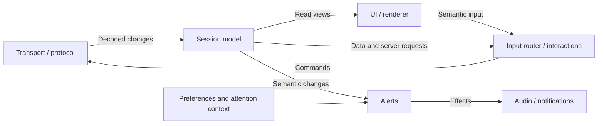

# Кодовая архитектура TomeNET SV

2026-09-21. Статус: согласовано. Решения интервью Q4–Q14 и целостный проект
подтверждены пользователем на финальной сверке. Описывает целевую архитектуру, а не полноту
текущей реализации. Термины: [CONTEXT.md](../CONTEXT.md).

## Цель и форма

Приоритеты — перенос игровых возможностей и дальнейшая переработка UX.
Правила проверяются отдельно от интерфейса; изменение компоновки и способа ввода
не требует переделки сетевой логики. Behavior baseline сохраняется, сервер
остаётся авторитетом игровых результатов.

Основа — модули с небольшими явными интерфейсами и владельцами состояния,
последовательная обработка входов в главном потоке и направленная передача
результатов. События используются по смыслу задачи; общая publish/subscribe шина
не является основой клиента. Механизм связи выбирается для конкретного интерфейса.

## Ответственность модулей

| Модуль | Ответственность |
|---|---|
| Application / lifecycle | Сборка зависимостей, порядок работы, создание и закрытие сессии, решение о её завершении |
| Transport / protocol | Соединение, частичные данные, версии протокола, перевод пакетов и смысловых команд |
| Session presentation model | Известные клиенту игровые данные, коллекции, запросы сервера, согласованное применение изменений и версии областей состояния |
| Input router / взаимодействия | Контексты и bindings, макросы, смысловой ввод, незавершённые выборы, подтверждения и отмена |
| Предупреждения | Реакции на игровые изменения с учётом настроек и контекста внимания игрока |
| UI / renderer | Отображение, локальное состояние представления, компоновка, производные кэши и графические ресурсы |
| Audio / внешние исполнители | Исполнение адресных результатов без знания правил их возникновения |

Это логические модули, а не требование создать по одному файлу для каждой строки.
Внутри модели статусы, инвентарь и сообщения могут иметь собственные подмодули;
взаимодействия могут разделяться по сценариям. Input router сохраняет владение
смысловым контекстом и незавершённым вводом через эти внутренние модули.

Application связывает устойчивые интерфейсы, без ветки на каждую игровую ситуацию.
Добавление предупреждения меняет соответствующее правило и при необходимости
исполнителя; появление новой ответственности уровня приложения может менять сборку.
Группировка результатов по получателям не разрешает менять значимый порядок исполнения.

## Размещение исходников

Текущее дерево `src/client/sv` сочетает группировку общих механизмов по
ответственности ([SV-ARCH-003](tasks/SV-ARCH-003-group-sv-sources-by-module.md))
и локальность сценария входа ([архитектура входа](tasks/login-architecture/README.md)).
Перенос входа от 2026-11-04 реализован только внутри SV; адресные Linux
проверки и ограничения записаны в [интеграционном отчёте](tasks/login-architecture/SV-LOGIN-ARCH-005-integration.md). Группировка файлов не отменяет принятые ADR:

| Путь внутри SV | Содержимое |
|---|---|
| `main.c`, `app.[ch]`, `result.[ch]` | Запуск, сборка модулей/lifecycle и общий контракт результата |
| `session/` | Модель сессии, предупреждения (`session`, `alerts`) и совместный SV-контракт `character-setup.h` |
| `protocol/` | Декодирование, сериализация, сравнение версий и локальные helpers |
| `input/` | Router, контексты/макросы и отдельный адаптер SDL-ввода |
| `ui/` | Общие layout/rendering utilities, шрифты, подготовка статуса и текста сообщений |
| `credential/` | Самостоятельный credential vault |
| `lua/` | SV-local startup Lua runtime, C-owned schools/spells и reload owner; существующий vendored Lua engine без legacy UI globals |
| `transfer/` | SV-local FILE receiver/sender, checksum и publication; startup adapter связывает registry с borrowed application Lua owner и login dispatch/tick |
| `settings/` | Собственные CFG/OPT data, startup overrides и initial audio adapter; явная передача settings/ресурсных результатов в login |
| `login/` | Сценарий входа: `flow`, `native-run`, `options`, `pregame`, `login-view`, `chronicle` |
| `login/servers/` | Выбор endpoint, metaserver |
| `login/account/` | Credentials interaction и presentation |
| `login/characters/` | Выбор персонажа и native name/login adapters |
| `login/creation/` | Birth interaction, private state, native adapter и описания выбора |
| `login/motd/` | MOTD presentation helpers |
| `login/ui/` | Shell/scene/layout входа, native endpoint adapter и frame view |

Includes используют явный путь от единственного корня SV, например
`session/session.h` и `ui/font.h`. Вложенные objects и `.d` dependencies сохраняют
эту структуру внутри изолированного output каталога соответствующей платформы.
Session использует локальный `protocol/hp-update.h` для baseline HP apply;
это существующая зависимость, сохранённая при переносе.

Сам физический перенос сохраняет interfaces и владельцев состояния; изменения
контракта входа описаны ниже. SDL-адаптер ввода
остаётся отдельным от headless router; `ui/status` готовит представление, а
семантическое состояние HP принадлежит session model. Диагностический launcher,
синтетическая UI-оболочка, bootstrap/peer, измерители и захват кадров находятся
в `tests/sv/diagnostics`, сценарии — в `tests/sv/scenarios`. `main.c` пока
делегирует общему launcher для сохранения существующего CLI; сборка явно
выделяет diagnostic objects. В production API остаются только общие границы
синхронного вызова и наблюдения; сценарные IDs и JSONL-отчёты ему не принадлежат.

Временные подстановки для ещё не подключённых возможностей вынесены в
[`src/temporary/sv/stubs`](../src/temporary/sv/stubs/README.md). Они используются
production-путём с явными именами `sv_stub_*` / `SV_STUB_*`: фиксированный
play profile и тексты незавершённых Guide/live-session surfaces. Диагностика
и тестовые fixtures в этот каталог не входят.

Сценарий входа управляется `login/flow.[ch]`: flow владеет endpoint,
credentials buffers и recovery draft; отдельная попытка внутри flow владеет
socket, generation, protocol login, pregame, birth и vault request. Детали
представления flow находятся в `login/flow-internal.h`; это private interface
для синхронных native adapters, не интерфейс renderer или внешних callers.
`login/native-run.[ch]` собирает SDL loop, доставку native ввода, время и rendering.
Вход снаружи вызывается через прежнюю функцию runner по новому пути;
`endpoint-run.[ch]` по прежнему пути не сохраняется.

Renderer принимает `SvEndpointView` из `login/ui/view.h`, отдельно от mutable
`SvEndpointInput`. Frame view передаётся синхронно: borrowed pointers действуют
до mutation/teardown; renderer их не удерживает. Взаимодействия владеют смысловыми
drafts, native слой — hover, focus, scroll и viewport. Draw и hit testing
используют общую logical geometry; возвращаемые render metrics не являются
мутацией interaction state.

Birth доступен внешнему production-коду через самостоятельный
`login/creation/birth-interaction.h`: opaque `SvBirth`, semantic commands,
read-only `SvBirthView`, проверенный `SvBirthPlayDraft` и diagnostic
`SvBirthSnapshot`. Snapshot — самостоятельное значение для наблюдения, его нельзя
применить обратно к interaction. Полное mutable состояние определено только в
private `login/creation/birth.h`; его используют core и native adapter внутри
creation. `view->setup` заимствован у попытки, поэтому view нельзя удерживать
через её mutation/teardown. Production core остаётся единственным.

Transport/wire protocol, generic text editing, font/render utilities и vault
сохраняют самостоятельность; их не переносят в login ради физической близости.
C009 добавляет application-owned Lua runtime в `login/native-run`: ранние локальные
скрипты загружаются без вымышленных server flags. `lua/reload` принимает accepted
INIT и END через явный production API, хранит process-sticky audio/Guide flags,
проверяет session generation и отдаёт раздельные transfer/runtime результаты.
C010 подключает actual transfer decoder и реальные features/open; C011 использует
их results для readiness. C014 принимает actual live adoption/teardown.

C011 добавляет `login/preparation.[ch]`: opaque owner удерживает flow с transport,
unread/pending offsets, character preferences/history и подготовленный `SvApp`.
Application preferences/effects копируются с identity исходных occurrences;
native runner передаёт lifetime Lua, audio, fonts и prepared graphics при
move-once take; full requested/effective refs и MapFont definitions сохранены
в owned snapshot без повторного resource loading.
Read-only view разделяет startup/identity/profile/runtime/Guide/transfer results;
inspection не повторяет загрузку и не потребляет effects. Public transport drains
сохраняют порядок wire tail → login output → app output. Actual C014 consumer
принимает этот owner, а не создаёт второй decoder или копию connection state.

Post-END preparation ingress использует настоящие поддержанные decoders и
`protocol/startup-prefix.[ch]` для necessary social/skill/rendering/map, item,
initial audio и unique-list framing до identity. Эти frames только сохраняются;
item models, audio playback и unique-list consumers остаются поздним owners.
Complete unapplied frames удерживаются FIFO с sequence/type; raw tail нельзя
получить раньше deferred prefix, already-applied effects не replay. FILE после
END обслуживает тот же C010 registry через public receive/pump/output contract.
Неизвестный consumer baseline сохраняет точный tail с явным incomplete result;
его нельзя пропускать сканированием bytes или выдавать unknown-packet recovery.
Identity проходит version-aware decode → session model → native view;
startup INS получает наиболее специфичный файл по accepted identity.
Character options загружаются до PLAY и передаются внутри его snapshot;
отдельный pre-PLAY OPTIONS не отправляется. Native controls удерживают один
ограниченный ingress batch через decoder WAITING; реальный network WAITING,
исчерпание бюджета и identity boundary завершают batch без сброса pacing deadline.
До live adoption native preparation допускает необходимое подтверждение pause,
готовый redraw и выход; пока PAUSE активен, assembly включает SDL text input
для printable acknowledgement и показывает подсказку. Остальные gameplay
executors остаются последующим этапам.
Полный live loop и обработка всего серверного потока этим core не принимаются.

## Потоки данных

Стрелки обозначают смысловые связи, собираемые приложением, а не обязательные
прямые вызовы между всеми изображёнными модулями.

Команда выражает намерение, которое может быть отклонено. Изменение описывает
полностью декодированные входные данные. Представление показывает текущее состояние.
Разовый результат требует реакции и не заменяется чтением последнего состояния.

## Главный цикл и доставка

1. Принять доступные входы без длительного блокирования главного потока.
2. Полностью обработать один вход: обновить модель, вычислить реакции, передать
   результаты исполнителям. Не ждать окончания звука или внешнего I/O.
3. Продолжать в пределах бюджета времени или числа входов; уступать UI между
   целыми входами. Сохранять порядок сетевых обновлений.
4. В фазе построения кадра читать согласованное состояние без его изменения,
   обновлять необходимые кэши и выполнять отрисовку.

Результаты фоновой работы поступают отдельными входами. Исполнитель не запускает
рекурсивное изменение модели. Очереди вводятся для необходимого откладывания;
они ограничены и имеют явные правила владения данными и обработки перегрузки.
Бюджет цикла не компенсирует один длинный обработчик: его работа должна оставаться
короткой либо разбиваться/выноситься в фон с сохранением смысловой целостности входа.

## Чтение состояния и стоимость UI

Малые значения возвращаются копией. Большие представления доступны только для чтения
на время построения кадра; заимствованные указатели не переживают эту фазу.
Между кадрами UI хранит собственное состояние отображения, устойчивые идентификаторы
и восстановимые производные данные, а модель остаётся источником истины.

Версии областей состояния позволяют не повторять чтение и подготовку неизменившихся
данных. Кэши учитывают также шрифты, масштаб, геометрию и другие входы представления.
Начинаем с крупных областей; детализацию изменений добавляем по измерениям.
Анимации и отрисовка имеют собственную частоту. Версии не заменяют доставку разовых реакций.

## Жизненный цикл и отказы

Действия и фоновые задачи сессии привязаны к её поколению. При закрытии прекращается
приём её команд и отменяются связанные взаимодействия. Запоздавшие результаты
не применяются к новой сессии; принадлежащие им ресурсы освобождаются.
Шрифты, аудиопаки и настройки приложения живут независимо от сессии.

Неисправность дополнительной возможности сообщается без автоматического разрыва
соединения. Устаревший выбор обрабатывается по правилам действия, частичный пакет
ожидает продолжения, восстановимые ошибки протокола следуют behavior baseline.
Невозможность сохранить корректность или обязательные данные завершает сессию
с понятной причиной, оставляя приложение работающим.

При перегрузке ограничивается приём новых данных, где транспорт это допускает,
и обрабатывается накопленное. Неограниченного роста памяти и молчаливого удаления
игровых изменений нет; если безопасное продолжение невозможно, сессия завершается.
Модули сообщают смысловые ошибки, решение о завершении принадлежит lifecycle.

## Проверка на сценариях

- **HP `50 → 10 → 50` при максимуме 100.** UI может показать итоговые 50;
  модуль предупреждений получает каждое изменение. При включённой настройке
  предупреждение для 10 не исчезает; сохраняются baseline-условия, включая
  повторные подходящие пакеты, а не только пересечение порога.
- **Чат.** Модель хранит упорядоченные сообщения и обрабатывает служебные изменения
  по протоколу. Представления истории и ленты могут обновляться реже поступления
  сообщений; одинаковый текст сам по себе не является основанием объединять поступления.
- **Выбор предмета и направления.** Взаимодействие хранит незавершённый шаг,
  UI представляет выбор, сеть продолжает обрабатываться. Актуальность выбора
  проверяется по правилам действия; отмена и макросы сохраняют baseline-семантику.
- **Переподключение.** Выбор и запоздавшая задача старого поколения не могут
  отправить команду или изменить состояние нового соединения.

## Перенос и проверка реализации

С 2026-09-22 применяется [правило изоляции SV](../AGENTS.md): оно уточняет
прежние требования к переиспользованию реализации. Отдельные предложения
рефакторинга и исправления существующего кода ведутся в
[списке улучшений](sv-improvements.md).

Корректировка уже начатого shell/HP-среза описана в задаче
[SV-ARCH-001](tasks/SV-ARCH-001-align-current-implementation.md).

Переносим по одной возможности: сохраняем проверенную семантику и самостоятельные
legacy-функции, перерабатываем связанные с терминалом сценарии. Начатый SV-код
также допускает переработку под принятые интерфейсы.
Для каждого переноса проверяются игровое поведение, отмена и макросы; правила
должны проверяться отдельно от настоящего окна и сервера. Это не заменяет проверки
реального рендеринга, протокольной совместимости и платформенного поведения.

## Детали следующих этапов

Архитектурные принципы выше согласованы. При реализации конкретных возможностей
ещё требуется определить, не подменяя эти вопросы скрытыми допущениями:

- C-типы, сигнатуры и внутреннее разбиение файлов, владение отложенными payloads.
- Порядок обслуживания независимых источников, конкретные бюджеты и размеры буферов.
- Протокол отмены фоновых задач и освобождения ресурсов.
- Соответствие контекста внимания нового UI legacy off-panel условиям предупреждений.
- Подробные переходы каждого взаимодействия и version-aware правила протокола.

Это сводка проектирования: производительность целевого цикла и полная совместимость
ещё не подтверждены реализацией. Текущее состояние описано в [sv-hp.md](sv-hp.md).

## Основания решений

- [ADR-0001: модель, взаимодействия и UI](adr/0001-separate-session-interactions-and-ui.md)
- [ADR-0002: главный поток и бюджет работы](adr/0002-main-thread-state-ownership.md)
- [ADR-0003: связи модулей и порядок обработки](adr/0003-explicit-module-connections.md)
- [ADR-0004: версии и кэши UI](adr/0004-revision-based-ui-views.md)
- [ADR-0005: поколение сессии](adr/0005-session-scoped-work.md)
- [ADR-0006: ошибки и перегрузка](adr/0006-errors-and-overload.md)
- [Исследование альтернатив](research/sv-client-architecture.md)
