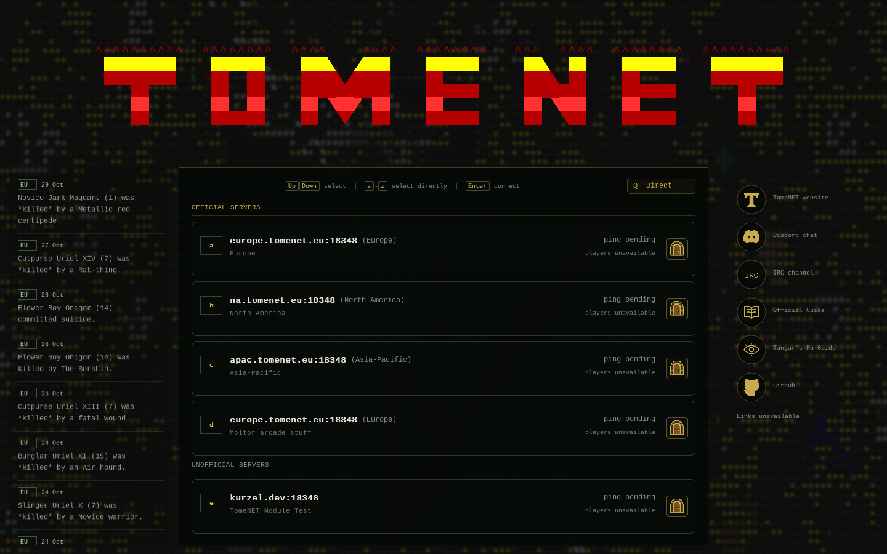

# B2 — blur, double click и возврат Back

2026-10-29. Исправлены три дефекта, сообщённые пользователем после запуска
клиента. Пользовательская visual acceptance B2 не объявляется.

Production executable SHA256:
`b6b6726d92df9ffe39513b0edc4b33586931bdbe84800d48a2154184ac3468b0`.

| Дефект | Причина и исправление | Проверка |
|---|---|---|
| Нет blur фона | После удаления downsample фон загружался в полном разрешении, но без фильтра. Добавлены `contrast(.78)` и Gaussian blur approximation тремя box passes на исходном разрешении. Радиус учитывает logical scale и cover transform. Подготовленные текстуры кэшируются; фильтрация не выполняется каждый кадр. | Production red→green sharpness ratio 1.0000→0.0097, ориентир Gaussian CSS 0.0104; actual software/OpenGL screenshots просмотрены. Все 19 исходных PNG неизменны. |
| Двойной клик по строке не подключает | Обработчик учитывал только клик по двери. `clicks >= 2` теперь вызывает production selection/connect для строки; одиночный клик остаётся выбором. | Минимальный production adapter regression и реальные X11 двойные клики на двух backend. |
| Back закрывает клиент | Caller credentials объединял отмену формы и выход в общий teardown. Разделены Back, закрытие окна, frame limit, ошибка и подтверждение. Видимый/focused Back напрямую отменяет форму из любого поля и возвращает существующее окно к списку. | Production scene regression и actual Back после password/reveal: окно живо, другой сервер открывается, пароль/reveal сброшены. Alt-F4 штатно закрывает клиент. |

Контекстный Escape сохраняет прежний шаг назад: из password возвращает к account,
из account — к списку серверов. Видимая кнопка Back всегда возвращает список.
Перед возвратом очищается пароль, отменяется vault lookup, сбрасываются reveal,
заимствованные presentation pointers и временный status. Server selection,
renderer/window и providers списка/Chronicle сохраняются. Протокол и игровая
семантика не изменены.

## Проверки и review

- `make -C src -f makefile.sv tomenet-sv -j4` — PASS.
- `python3 tests/sv_endpoint_checks.py` — PASS:
  [log](evidence/sv-b2-interactive-bugs/endpoint-checks.log).
- `SDL_VIDEODRIVER=dummy python3 tests/sv_shell_smoke.py --backend software` — PASS.
- Реальные X11 software/OpenGL: double click → account → password/reveal → Back →
  server list → другой сервер → account — PASS. Поля пусты, reveal выключен.
  Закрытие окна проверено отдельно.
- Независимое source/visual review: замечание о Back из password исправлено;
  открытых замечаний к production delta нет.

Минимальные регрессии используют существующие `native-endpoint.c`,
`credentials.c`, `scene.c` и production functions. Прежний scene test зависел от
начала input через фиксированную задержку и ping update на 32-м кадре. После
подготовки blur input мог прибыть до входа в scene и корректно отбрасывался
timestamp guard. Тест теперь ждёт readiness существующего source-poll seam,
а ping обновляется после нужного selection state; sleeps не увеличены.
Новых suites или постоянного runtime framework не добавлено.

Подробности и ограничения:
[independent review](evidence/sv-b2-interactive-bugs/review.md),
[software assertions](evidence/sv-b2-interactive-bugs/final-software.json),
[OpenGL assertions](evidence/sv-b2-interactive-bugs/final-opengl.json),
[blur evidence](evidence/sv-b2-interactive-bugs/blur-validation.txt).
В runtime использованы пустые disposable profiles и fabricated test data;
real-account authentication/gameplay этим не заявляются. Chronicle в successful
runs получила все девять HTTPS-источников; сетевые отказы отдельных запусков
сохранены честно и не заменены offline snapshot.

